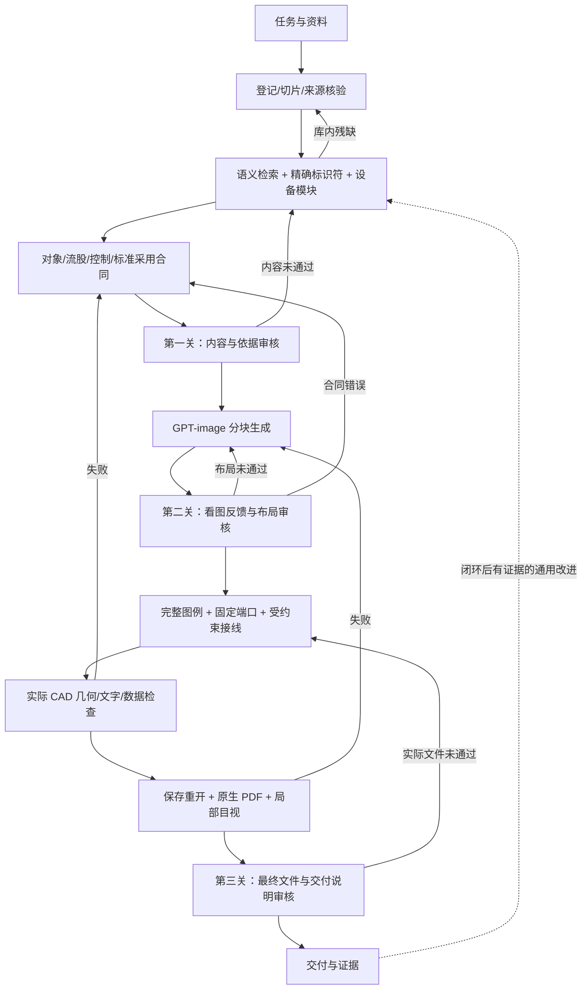

# 基于 GPT-image 的化工 PFD/PID 绘图工作流

作者：milklong（GitHub：milklong888） · [版权、来源与AI辅助编辑声明](ATTRIBUTION.md)

> 验证边界：大型案例的历史成果是分图集，完整跨块管线合并与该案例配套 PID 尚在修正。分图原生检查通过不等于整图已交付，详见验证范围。

先查资料、冻结真实对象与接口，再由 GPT-image 策划图面，最后以可追溯图例、受约束接线和 CAD 实际回读完成绘图。

这是一个面向代理的绘图工作流与工具项目：**5 个总分 Skill、来源知识组织、图面策划提示、可执行检查和对抗验证方法**。ImageGen 是新图布局的核心；工艺数据、元件、控制关系和工程采用来自来源合同。图像不能代替设计依据。

公开版 **0.1.3**，由本地工作流 **4.17** 整理。旧绘图主入口不随包发布；保留有价值、可独立维护的模块。自有代码、工作流和文档按 [MIT](LICENSE) 开源，第三方和未随包资料见 [来源与许可](THIRD_PARTY_NOTICES.md)。GPT-image 服务、模型权重、AutoCAD 和受控标准不是本项目开源的部分。

[架构](docs/ARCHITECTURE.md) · [训练与对抗验证](docs/TRAINING_AND_EVALUATION.md) · [验证范围](docs/VALIDATION_STATUS.md) · [安装与运行](docs/INSTALL.md) · [公开范围](docs/OPEN_SOURCE_SCOPE.md)

## 工作流



Aspen只需要PFD排布时，可用[Image布局前段](skills/chemical-pfd-pid-cad/references/IMAGE_LAYOUT_HANDOFF.md)：完成检索、内容审核、Image生成与看图反馈后返回图块及跨块接口，不进入CAD重建。Aspen实施及其文件验收仍由调用方负责，公开包不包含通用Aspen坐标实施器。

## 各部分做什么

|模块|责任|
|---|---|
|总控 Skill|识别图种、安排检索与反馈、控制进入下一阶段的条件|
|PFD Skill|物料/能量流向、设备、特征工况和同号流股表|
|PID Skill|技术连接、管线与仪表、测点—控制器—执行器/SP关系|
|设备图 Skill|已有设备设计的视图、尺寸、管口表和条件表达|
|知识 Skill|来源登记、切片、向量/关键词/图谱、模块挂接和溯源补库|
|检查工具|检查明确合同与实际数据；不靠模型自评决定通过|

可运行源码：[知识引擎](skills/chemical-pfd-pid-cad/tools/drawing-knowledge/README.md)、[几何/路由/连续桥/箭头顺序](skills/chemical-pfd-pid-cad/tools/geometry/README.md)、[尺寸审计](skills/chemical-pfd-pid-cad/tools/dimensions/dimension_audit.py)。几何组件的 58 项合成测试包含实际 libavoid 路由；原生读取源码另有编译与执行边界。

知识组织复用 **LlamaIndex、Docling、LinkML、BGE**，而不是另造检索框架。思想组织参考同作者的 [化工设计专家工作库](https://github.com/milklong888/chemical-engineering-skills)：先冻结范围和依据，再实现，再检验；任务经验经过审阅后才进入共享规则。

## 快速开始

```sh
python -m venv .venv
# 激活环境后
python -m pip install -r requirements.txt
python -m unittest discover -s tests -v
python scripts/install_skills.py --destination /your/agent/skills
```

安装器默认拒绝覆盖已有同名 Skill；先指定新的目录试用。具体知识库初始化、可选依赖及代码入口见 [安装文档](docs/INSTALL.md)。将五个 Skill 放到代理可发现的目录后，给出资料与明确任务。需要支持图像生成的代理/服务；这个仓库不会仅凭一句自然语言自动交付已核准 DWG。

## 重点约束

- 策划时实际检索；遇到新设备、接口或服务补查对应模块。编号相近、同目录、OCR 高置信度都不等于同一来源。
- 适合图种的原图例完整保留；不适合的留给设备设计，不默认简化或发明元件。
- 接口位置、旋转后法向、全线障碍与线头、重叠、无意义折线分别检查；所属设备不获得整台豁免。
- 非连接交叉按本项目约定使用连续拱桥；桥不改变连接合同，也不宣称所有标准都规定如此。箭头置顶检查实际绘制顺序。
- 原值 R、推导值 D、授权合成值 S、缺项分别保留。训练值必须逐字段标明，不能回写为来源或工程设计值。
- 沿用本项目约定：文献未标压力基准时采用绝压，来源栏仍记“未注明”；项目明示优先，不自动换算大气压。
- 控制先核目标、约束和自由度，联合检查产量、库存及能量稳定，再处理质量/监督层；设计、整定与开车顺序不同。
- 设置[三道审核关口](skills/chemical-pfd-pid-cad/references/INDEPENDENT_REVIEW.md)：送入 ImageGen 前查内容与依据，生成后看图反馈，交付前验实际文件与说明。未关闭的硬错误或必要范围未审阻止相应阶段放行；修改后重验受影响的下游。软件发布通过不代表图纸验收通过。

## 验证与“训练”

这里的训练指**检索、提示、工作流、知识卡片和检查器的对抗迭代**，没有训练或微调 GPT-image/语言模型权重。原始答案和失败记录保留；修正原题是回归，新来源新上下文才是泛化。详见 [训练说明](docs/TRAINING_AND_EVALUATION.md)。

历史本地大型案例完成了 8 次图像生成、5 工段/19 分图、20 页原生出图，核对 103 设备位号、246 接口、31 对跨页接续、24 处连续桥和 201 个置顶箭头。原图纸与本地证据未作为开放数据发布，因此这些是**历史有界结果**，不能用公开测试重跑来冒充，也不证明任意新 PID 已可自动生成。

欢迎提交可公开的最小反例、受许可保护的代码改进和有来源的规则修正；不要上传受控图纸、标准全文、访问令牌或模型权重。见 [贡献方式](CONTRIBUTING.md)。
