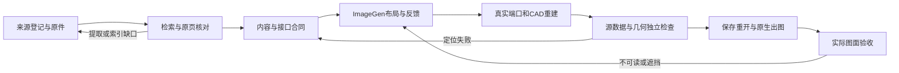

# 架构：从依据到可核验图纸

> 验证边界：大型案例的历史成果是分图集，完整跨块管线合并与该案例配套 PID 尚在修正。分图原生检查通过不等于整图已交付。

本项目组织化工 PFD、P&ID 和设备条件图的资料读取、检索、布局与验收。核心是让每个设备、字段、接口和改动能追到依据，并在真实文件中复核。它不替代工艺设计、设备计算、控制动态验证或专业签发。

公开范围以发行清单为准：独立归属可确认的新检索与工作流实现、可公开的 CAD 核验工具和合成示例。许可不兼容或归属未确认的旧衍生代码、原图库、标准/专著正文、私有案例与本机运行环境不随仓库公开。历史完整版的执行记录不能代表公开包包含其全部组件。

## 一条主链，按阶段进入

来源层先登记原文件、成员别名和内容哈希，原件保持只读。已有原生 CAD 优先读文字、块、属性、句柄和图层；扫描件需要结构提取/OCR与原页核对。提取结果默认是候选。来源身份、条文内容、标准现行性和项目适用性分别核实。

检索层从图种、设备服务、邻接关系、阶段和实际缺口生成检索包，再读命中切片、父条款、条件/例外和完整原图例。只命中来源目录时继续导航到原页或原生句柄；未命中不能直接宣布原资料没有。回执绑定当前知识版本与内容，防止过期或错范围使用；它证明检索记录存在，不证明语义理解正确。

合同层冻结设备/流股台账、图例身份、端口、方向、跨块接续、准确文字和字段状态。已知但未读、来源有值但未获项目采用、真正缺失须分开。来源冲突保留并明确影响范围；图像不得替作者选择工艺版本。

ImageGen负责布局候选与反馈：阅读顺序、分组、留白、跨块总体排版和标签位置。元件、位号、数值、连接和控制配对仍由合同决定。图像中的错字、错号和错接不能随有用的版式进入 CAD。大流程按功能和真实接口分块，逐块反馈后再拼接；全图另查漏接、重复、方向、回流、跨页双端数据和拼接碰撞。

CAD 层将布局落实为可编辑图元，保存源身份及允许变换，转换端口位置和向外法向。整块复制不自动证明内部连接、符号用途或精度合格。未被通用入口支持的拓扑需单独实现与验证，不能静默丢掉共享端口、三通或跨越。

最后分开检查源内容、几何、字段、字体与打印效果。原生保存、关闭、重开后检查交付文件的实际图元、文字范围、有效样式和绘制顺序，再看原生 PDF。哈希绑定检查对象，独立预期和实际求值决定通过；哈希本身不是正确性证明。

## 总控与四个专项

| 入口 | 负责内容 | 边界 |
| --- | --- | --- |
| `chemical-pfd-pid-cad` | 任务识别、阶段编排、共同约束、验收交接 | 不自己补造流程或控制设计 |
| `chemical-pfd-drawing` | 设备与物料/能源路径、操作条件、关联流股表 | 不替代 PID 施工细化或完整衡算 |
| `chemical-pid-drawing` | 技术连接、测点、执行器、信号、控制结构 | 不从模板推定联锁定值、SIL或保护设计 |
| `chemical-equipment-drawing` | 已核设备条件、管口、尺寸/方位及视图关联 | 不替代制造计算或设备专业核准 |
| `chemical-drawing-knowledge` | 登记、去重、提取、审核、检索、补库与失效管理 | 不将案例或制造总装自动批准为 PFD 图例 |

总控只保留触发与强约束；方法在专项引用中，执行逻辑由单一维护位置负责。工程判断与软件执行分开：执行层可以指出阻塞，不能为了出图顺利静默重设计。局部审图或已核布局修复从对应阶段进入，不强制重复无关步骤。

## 知识图谱与检索结构

LinkML定义节点、关系和字段，LlamaIndex组织文档、语义向量、BM25和属性图；Docling等提取工具负责结构/OCR候选。三者承担不同工作，schema通过不表示条文读对。

图谱的实际节点类型包括 `Source`、`StandardVersion`、`ClauseCandidate`、`CasePattern`、`Requirement`、`Module`、`EquipmentConcept`、`DrawingKind`、`Field`、`SymbolRepresentation`、`Port` 和 `Check`。`evidenced_by`保留依据，`applies_to`限定适用范围，`depends_on`连接依赖，`supersedes`保留替代历史。设备模块是对同一来源节点的视图，不另抄一套规范。

节点保存来源身份与哈希、页/条款或句柄、条件、例外、适用图种和审阅状态。`extracted_candidate`、`reviewed_historical`、`reviewed_case`与`project_approved`不可混用。未核准的块可保留完整定义供来源研究，但不能因“有块”就进入可复用符号通道。来源/正文/载荷变化要使依赖索引、检索包和下游产物失效；原文件和历史记录保留。

## 数据与控制的采用规则

流股字段分别记录原文 reported、可追溯 derived、用户授权的训练 synthetic 和 missing。训练场景另版，表格逐字段标明状态，图签简洁说明训练用途；S不能洗成R，缺项不能因训练场景而假造为有来源。它们不自动成为 HMB 或工程核准值。

本工作流的压力采用约定是：原文未注明绝压/表压时按绝压采用，明确项目/原文说明优先。保存原值、原单位和“原文未注明”，另记采用依据；不写成来源明示，不自动增减大气压。该约定需在项目数据合同中可见。

控制结构先冻结目标、约束、扰动和自由度，再联合处理产量点、库存、压力/能量及回流稳定化，随后配置质量与监督层；快速质量硬约束可进入稳定层。逐回路核测量对象、操纵量、命令归属、串级SP和执行器争用。设计顺序、整定顺序和投运顺序分开；图形正确、结构合理、动态性能通过是三项不同结论。

项目采用的跨越和箭头表达也进入合同。连续拱桥尺寸须经局部空间及实际打印可读性核对，不冒称统一标准尺寸；箭头置顶须核真实绘制顺序和原生出图，不能只看图层名。标准编号、HG/T或GB前缀、分册、版本及采用差异逐项记录，不能笼统声称全标准合规。

本架构借鉴化工专家工作流的分层责任、证据分类、指定方法保持、阶段验收和受控经验整理。它没有将完整化工专家计算能力自动带入本绘图项目。改进与验证方法见[训练与评估](TRAINING_AND_EVALUATION.md)，实际覆盖见[验证状态](VALIDATION_STATUS.md)。
